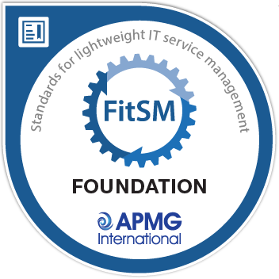

::: {.cv-download .content-visible when-format="html"}
[Download as PDF](cv.pdf){.btn-pill}
:::

::: {.content-visible when-format="pdf"}
Training & Industry Outreach Coordinator and Data Scientist, NBIS / SciLifeLab, Uppsala, Sweden\
Associate Professor of Bioinformatics, Uppsala University\
[kierczak.net](https://kierczak.net) · [ORCID 0000-0003-2629-5655](https://orcid.org/0000-0003-2629-5655) · [Google Scholar](https://scholar.google.com/citations?user=ebOBIL4AAAAJ) · [LinkedIn](https://www.linkedin.com/in/marcinkierczak)
:::

## Profile

Bioinformatician and data scientist with a background in machine learning and statistical genomics. I coordinate training and industry outreach at the National Bioinformatics Infrastructure Sweden (NBIS), part of SciLifeLab, and am an associate professor of bioinformatics at Uppsala University. My research covers complex-trait and cancer genomics, conservation and ancient genomics, and metagenomics, mostly in collaboration with groups across Sweden. Since 2018 I co-organise RaukR, an advanced R summer school.

## Experience

::: entry
::: when
2024 – present
:::
::: what
**Training & Industry Outreach Coordinator, Data Scientist**

::: where
National Bioinformatics Infrastructure Sweden, SciLifeLab, Uppsala
:::
:::
:::

::: entry
::: when
2017 – 2024
:::
::: what
**Bioinformatics Data Scientist**

::: where
National Bioinformatics Infrastructure Sweden, SciLifeLab, Uppsala. Long-term support group (WABI)
:::
:::
:::

::: entry
::: when
2014 – 2017
:::
::: what
**Researcher**

::: where
Kerstin Lindblad-Toh's lab, Uppsala University & SciLifeLab
:::
:::
:::

::: entry
::: when
2010 – 2014
:::
::: what
**Postdoctoral researcher**

::: where
Örjan Carlborg's computational genetics group, Swedish University of Agricultural Sciences
:::
:::
:::

::: entry
::: when
2006 – 2010
:::
::: what
**Web consultant & database engineer**

::: where
Global Diversity Foundation
:::
:::
:::

## Education

::: entry
::: when
2006 – 2009
:::
::: what
**PhD in Bioinformatics**, awarded December 2009

::: where
Linnaeus Centre for Bioinformatics, Uppsala University. Thesis: [*From Physicochemical Features to Interdependency Networks: A Monte Carlo Approach to Modeling HIV-1 Resistome and Post-translational Modifications*](https://urn.kb.se/resolve?urn=urn:nbn:se:uu:diva-109873). Supervisor: Prof. Jan Komorowski; co-supervisor: Dr. Gunnar Andersson; opponent: Prof. Anna Tramontano
:::
:::
:::

::: entry
::: when
2003 – 2005
:::
::: what
**MSc, Molecular Biology**

::: where
Uppsala University. Thesis: *Rough Set-Based Classifiers for Predicting HIV-1 Resistance to NRTI Drugs*
:::
:::
:::

::: entry
::: when
2000 – 2003
:::
::: what
**BSc, Molecular Biology**

::: where
University of Warsaw. Thesis: *Role of CDK-5 Kinase in the Mammalian Central Nervous System*
:::
:::
:::

## Academic title

Associate professor (docent) in bioinformatics, Department of Cell and Molecular Biology, Uppsala University.

## Certifications and training

::: entry
::: when
[{width=72px fig-alt="FitSM Foundation badge"}](https://www.credly.com/badges/2be1b9ca-e588-441e-ad42-72184e8c0735)
:::
::: what
**FitSM® Foundation**

::: where
Issued by APMG International, May 2026. [Verify credential](https://www.credly.com/badges/2be1b9ca-e588-441e-ad42-72184e8c0735)
:::
:::
:::

::: entry
::: when
2015
:::
::: what
**From Research to Business**

::: where
Course by [ESBRI](https://esbri.se/), on commercialising research. Participant.
:::
:::
:::

## Teaching and course organisation

- **RaukR**, *Advanced R Programming for Bioinformatics*, Visby. Co-organiser, annually since 2018.
- **R for non-programmers** and **Advanced R for data scientists**. Course leader.
- **R Programming for Life Scientists**, SciLifeLab, 2015–2020. Course responsible; teacher 2015–2017.
- **Statistical Methods in Genetic Mapping: An R-based Course**, 4 ECTS graduate course, 2013. Course responsible and teacher.
- **LUPA Workshop: GWAS Analyses in Stratified Populations**, Uppsala, 2011. Course responsible.
- **Next-Generation Sequencing: Bioinformatics and Data Analysis**, PhD-level course. Course responsible.
- **Boolean Reasoning** and **Knowledge-based Systems in Bioinformatics**, Uppsala University. Teacher and teaching assistant.

## Invited and popular-science talks

- **From mythology to artificial intelligence: a short journey through statistical models** (in Swedish). Public lecture, [13x13](https://www.uu.se/institution/fysik-och-astronomi/samverkan/13x13/13x13-2025), Uppsala University, 5 November 2025.

## Supervision and examination

- **Examiner, PhD theses** (2): M. Dahlö (2021), A. García-Montaner (2020).
- **Opponent, licentiate thesis** (1): K. Ausmees (2019).
- **Co-advisor, PhD theses** (3): S. Sakthikumar (2020), S. Forsberg (2016), M. Ahsan (2014).
- **Subject reviewer, master's theses** (2): Y. Utkueri (2024), M. Qvarnlöf (2024).
- **Master's and research-project supervision**: further projects, listed on the [Training & Outreach](https://kierczak.net/teaching.html#supervision) page.

## Selected publications

36 peer-reviewed articles and preprints;  citations, h-index , i10-index  (Google Scholar, ). The full list is on the [publications page](https://kierczak.net/publications.html).

- [Bayesian mixed model analysis uncovered 21 risk loci for chronic kidney disease in boxer dogs](https://doi.org/10.1371/journal.pgen.1010599). *PLOS Genetics*, 2023.
- [Contribution of rare whole-genome sequencing variants to plasma protein levels and the missing heritability](https://doi.org/10.1038/s41467-022-30208-8). *Nature Communications*, 2022.
- [GenErode: a bioinformatics pipeline to investigate genome erosion in endangered and extinct species](https://doi.org/10.1186/s12859-022-04757-0). *BMC Bioinformatics*, 2022.
- [Genomic insights into the conservation status of the world’s last remaining Sumatran rhinoceros populations](https://doi.org/10.1038/s41467-021-22386-8). *Nature Communications*, 2021.
- [Genetic Barriers to Historical Gene Flow between Cryptic Species of Alpine Bumblebees Revealed by Comparative Population Genomics](https://doi.org/10.1093/molbev/msab086). *Molecular Biology and Evolution*, 2021.
- [Pre-extinction Demographic Stability and Genomic Signatures of Adaptation in the Woolly Rhinoceros](https://doi.org/10.1016/j.cub.2020.07.046). *Current Biology*, 2020.
- [SETD2 Is Recurrently Mutated in Whole-Exome Sequenced Canine Osteosarcoma](https://doi.org/10.1158/0008-5472.can-17-3558). *Cancer Research*, 2018.
- [Genome-Wide Analysis in German Shepherd Dogs Reveals Association of a Locus on CFA 27 with Atopic Dermatitis](https://doi.org/10.1371/journal.pgen.1003475). *PLoS Genetics*, 2013.

## Skills

::: {.content-visible when-format="html"}
**Tools**

::: chips
[R]{.chip .i-r} [Python]{.chip .i-python} [Nextflow]{.chip .i-nextflow} [Snakemake]{.chip .i-pipeline} [HPC environments]{.chip .i-server}
:::

**Methods**

::: chips
[Machine learning]{.chip} [Feature selection]{.chip} [Statistical genetics]{.chip} [Proteomics]{.chip} [Reproducible research]{.chip} [Explanatory programming (tidyverse)]{.chip}
:::
:::

::: {.content-visible when-format="pdf"}
R, Python, Nextflow and Snakemake workflows, HPC environments, machine learning and feature selection, statistical genetics, proteomics, reproducible research and explanatory programming (tidyverse).
:::

## Languages

::: {.content-visible when-format="html"}
::: chips
[Polish [native]{.lvl}]{.chip .f-pl} [English [fluent]{.lvl}]{.chip .f-gb} [Swedish [fluent]{.lvl}]{.chip .f-se} [French [basic]{.lvl}]{.chip .f-fr} [Latin [basic]{.lvl}]{.chip .i-column} [Spanish [basic]{.lvl}]{.chip .f-es}
:::
:::

::: {.content-visible when-format="pdf"}
Polish (native) · English (fluent) · Swedish (fluent) · French, Latin and Spanish (basic)
:::

*Last updated October 2026.*
