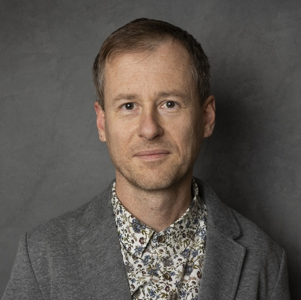

::: hero
{fig-alt="Portrait of Marcin Kierczak"}

::: {}
# Marcin Kierczak
::: role
Training & Industry Outreach Coordinator · Data Scientist · NBIS
:::

I coordinate training and industry outreach at the [National Bioinformatics Infrastructure Sweden (NBIS)](https://nbis.se), part of [SciLifeLab](https://www.scilifelab.se), connecting Swedish life science with the bioinformatics skills and expertise it needs. As a data scientist at NBIS, I also work with research groups on their data analysis. In addition, I am an associate professor of bioinformatics at Uppsala University, with a research background in machine learning, statistical genomics and ancient DNA.

::: links
[Training & Outreach](teaching.qmd){.btn-pill}
[Research](research.qmd){.btn-pill}
[Publications](publications.qmd){.btn-pill}
[Blog](blog.qmd){.btn-pill}
:::
:::
:::

## What I do

::: cards
::: card-s
### Training
Coordinating NBIS courses and workshops that build data-analysis skills across Swedish life science.
:::
::: card-s
### Industry outreach
Opening NBIS expertise and training to companies and industry partners.
:::
::: card-s
### Data science
Supporting research groups across Sweden with statistics, machine learning and reproducible data analysis, from experimental design to final results.
:::
:::

## Expertise

::: cards
::: card-s
### Machine learning & AI
Neural networks and ensemble methods applied to genomic and clinical data.
:::
::: card-s
### Statistical genomics
Association studies, mixed models and rare-variant analysis in humans and animals.
:::
::: card-s
### Ancient & conservation genomics
Genome erosion, demographic history and adaptation in endangered and extinct species.
:::
::: card-s
### Metagenomics
Metabarcoding and community profiling, from food quality control to ecology.
:::
:::

## Latest from the blog

::: {#latest-posts}
:::

[All posts →](blog.qmd)

## Affiliations

Training and industry outreach coordinator and data scientist at NBIS, SciLifeLab, and associate professor in bioinformatics at the Department of Cell and Molecular Biology, Uppsala University. Since 2018, co-organiser of [RaukR](https://raukr.nbis.se), an advanced R summer school in Visby ([more](teaching.qmd#raukr)).

## Beyond the lab

Microcontrollers and electronics, 3D printing, software-defined radio, jazz, sailing and celestial navigation.
