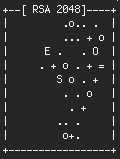

::: {.callout-note}
## From the archive
This merges three short posts from my old blog (*Bash one-liners, text manipulation*, *Bash shells and aliases* and *Automatic SSH login*, all February 2011). I have corrected a few mistakes in the originals and updated a few commands that have since changed. The corrections are listed at the end.
:::

## Text one-liners

Bash is very powerful for text manipulation, and you can save a lot of time by learning a few short commands, the so-called one-liners.

To convert a string to upper case (or lower case), use `tr`:

```bash
echo "lowercase" | tr "[:lower:]" "[:upper:]"
# LOWERCASE
```

Two commands that are indispensable for any bioinformatician when checking large files are `head` and `tail`, which show the first or last N lines of a file:

```bash
head myfile.txt            # the first 10 lines
head -n 5 myfile.txt       # only the first 5 lines
tail -n 5 myfile.csv       # the last 5 lines
tail -n +2 myfile.csv      # everything from line 2 on (skips the header)
```

Now the really useful part: you can chain these commands with a pipe.

```bash
head -n 10 myfile.txt | tail -n 5   # lines 6 to 10
```

Quite often you need only a part of a line. Say you have the line `Accuracy.mean=0.98` and you want just `0.98`:

```bash
acc_mean=$(grep "Accuracy.mean" myfile.txt | awk -F= '{print $NF}')
```

And when a line contains unwanted spaces, here is the remedy:

```bash
echo "   I   a m    full of s p a ces  " | tr -d " "
# Iamfullofspaces
```

## Start-up files and aliases

Some commands are long and cumbersome to type, yet you need them several times a day. **Aliases** are a good remedy.

Each user has two important files in the home directory: `.bash_profile` and `.bashrc`. They are read by a *login shell* and a *non-login shell*, respectively. A login shell is the one you get when you log in; every shell you open after that is a non-login shell. Typically, commands you want to run only at login, such as displaying system or network information, go into `.bash_profile`, and everything else, including aliases, goes into `.bashrc`. To avoid repetition, end your `.bash_profile` by including `.bashrc`:

```bash
if [ -f ~/.bashrc ]; then
   source ~/.bashrc
fi
```

**macOS users:** Terminal opens a login shell every time, so it reads `.bash_profile` (or `.zprofile`/`.zshrc` if you use zsh, which is the default today).

**Beginners' note:** file names that start with a dot, such as `.bashrc`, are hidden. You can see them with:

```bash
ls -al
```

Say you often use `ls -alh`, which lists all files, including hidden ones, with their sizes in human-readable form. To have something shorter, add this line to the end of your `.bashrc`:

```bash
alias ll='ls -alh'
```

From now on, typing `ll` gives you all the information about your files. After editing the profile files, re-open the shell (or run `source ~/.bashrc`) to use the aliases.

A useful maintenance alias on Debian or Ubuntu updates the whole system with one word:

```bash
alias admin='sudo apt update && sudo apt -y full-upgrade && sudo apt -y autoclean'
```

## Logging in over SSH without a password

If you log into a server over SSH several times a day, typing the password every time gets annoying. It is easy to set up key-based login. Suppose you want to allow your `workstation` to connect to the `server`. First, generate a key pair on the workstation:

```bash
ssh-keygen -t ed25519
```

and answer the questions: where to save the key, and an optional passphrase (a passphrase is a good idea). The command prints a fingerprint and a small picture, the key's *randomart*:

{width=125}

The image is a visual representation of the key's fingerprint. It is meant to be easier for humans to compare and verify than a string of hexadecimal characters, such as `ef:f2:5b:9c:…`. They are fun, anyway.

Now the public key has to be added to the list of trusted keys on the server. The simplest way is:

```bash
ssh-copy-id user@server
```

This creates `~/.ssh` on the server if needed and appends your public key to `~/.ssh/authorized_keys`. If `ssh-copy-id` is not available, the same can be done by hand:

```bash
ssh user@server mkdir -p .ssh
cat ~/.ssh/id_ed25519.pub | ssh user@server 'cat >> .ssh/authorized_keys'
```

You should now be able to log in without typing the password. If it still asks, check the permissions on the server: `~/.ssh` should be `700` and `~/.ssh/authorized_keys` should be `600` (or at least not writable by others).

## Corrections to the original posts

- `tail -n myfile.csv` was missing the number; `tail +2` is the obsolete form of `tail -n +2`.
- `head -n 10 … | tail -n 5` shows lines **6 to 10**, not "5 to 10".
- `awk '{FS="="}…'` sets the separator too late for the first line; `-F=` is the right way.
- The `ll` alias was announced as `ls -alh` but defined as `ls -al`; it is now `ls -alh`.
- The `admin` alias used `aptitude`; it now uses `apt`.
- The SSH key type was RSA (`ssh-keygen -t rsa`); `ed25519` is the usual choice today, and `ssh-copy-id` replaces the manual steps.
