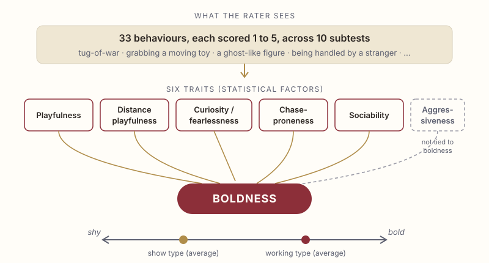
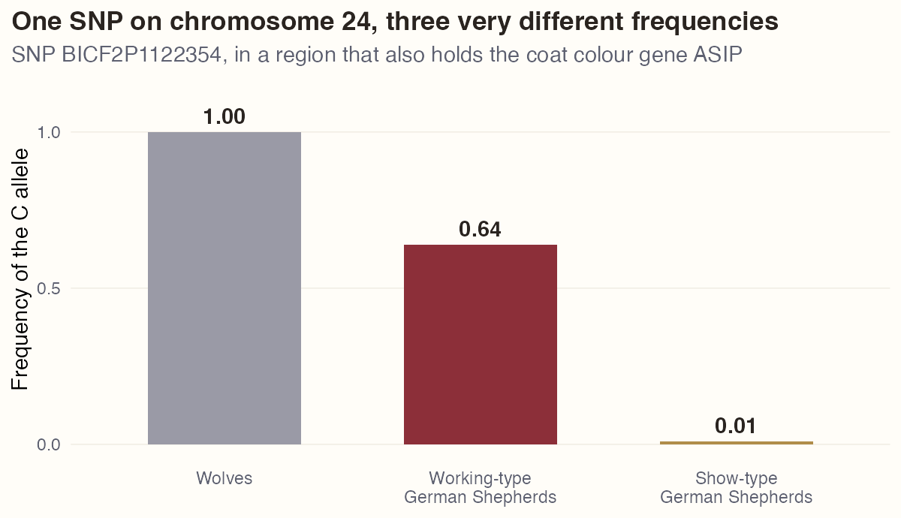
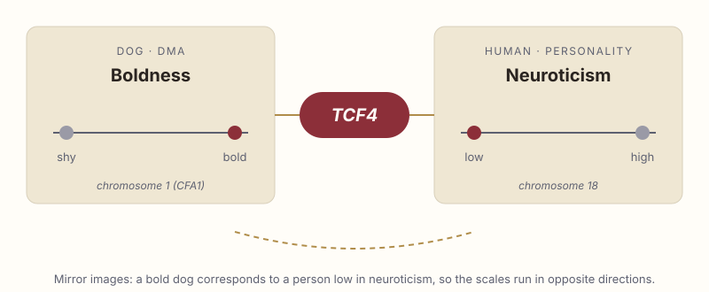

::: {.callout-note}
## The paper
Marinescu VD, Svartberg K, **Kierczak M**, Tengvall K, Bianchi M, Jabłońska J, Arvelius P, Sakthikumar S, Farias FHG, Karlsson ÅE, Pettersson ME, Wilsson E, Strandberg E, Hedhammar ÅA, Lindblad-Toh K (2026). *The Genetic Architecture of Behavior in the German Shepherd Dog.* Animal Genetics 57(6): e70221. [doi:10.1002/age.70221](https://doi.org/10.1002/age.70221). Open access.

Both SLU and Uppsala University wrote short news items about it: [SLU](https://www.slu.se/en/news/2026/11/curiosity-and-fearlessness-apparent-in-german-shepherd-genes/), [Uppsala University](https://www.uu.se/en/press/press-releases/2026/2026-11-12-curiosity-and-fearlessness-apparent-in-german-shepherd-genes).
:::

Throw a tennis ball for a working German Shepherd and it is gone before your arm has stopped moving. Throw it for a show-bred Shepherd and you may get a more thoughtful look. Anyone who has spent time with the breed knows this. What we wanted to know was whether the difference is written in the DNA.

.](working-dog.jpg){width=55% fig-align="center" fig-alt="A German Shepherd on a leash walks between laundry carts, ears up and tongue out, next to the legs of its handler."}

## One breed, two kinds of dog

The German Shepherd began as a working dog at the end of the 19th century. Soon people also started to breed for looks, and dog shows rewarded dogs that matched the breed standard, with its typical sloping back and angled hind legs. The split between a working type and a show type was already visible in 1909, and it is still there today.

.](hist-1891.jpg){width=55% fig-align="center" fig-alt="Sepia photograph of a rough-coated, wolf-like dog standing on cobblestones, in an oval frame. The caption reads: I. Preis, Deutscher Schäferhund, Stoppelhopser."}

So we have one breed with two sub-populations, bred for different things for over a hundred years. That makes a nice natural experiment. The dogs share much of their genetic background but were selected for different jobs. If selection changed the behaviour, it should have left traces.

## How do you measure a dog's personality?

You cannot put a dog on a scale and read off its courage. Fortunately, Sweden has a tool for this: the **Dog Mentality Assessment**, or DMA, developed by the Swedish Working Dog Association and studied for years by my co-authors Kenth Svartberg and Per Arvelius. A trained rater watches the dog go through ten situations. Does it want to play? Does it chase a moving toy? How does it react to a strange, ghost-like figure, or to a stranger who handles it? The rater scores 33 behaviours on a scale from 1 to 5. If you want to see what the test looks like, there is a [short film of a DMA session](https://vimeo.com/917811308/11bb0a046b) (film: Voichita Marinescu).

Statistically, these 33 scores collapse into six traits, such as playfulness, curiosity and fearlessness, sociability and aggressiveness. Most of the traits move together, and one higher-level factor sits on top of them. It is called **boldness**, and it describes where a dog falls between shy and bold. It is the dog version of something personality psychologists know well: a bold dog is roughly an extravert with low neuroticism.

{width=80% fig-align="center" fig-alt="Diagram. At the top, 33 behaviours scored 1 to 5. Below, six traits: playfulness, distance playfulness, curiosity and fearlessness, chase-proneness, sociability and aggressiveness. Five of them feed into a single trait called boldness, which runs from shy to bold; aggressiveness is not tied to it. Working dogs sit towards the bold end, show dogs less so."}

Most Shepherds in Sweden have taken the DMA, so we had results for 23,109 dogs. For the genetics we had 373 of them, genotyped on a SNP array with about 170,000 markers.

## What we found

**The breed splits in two, genetically.** When we looked at how related the 373 dogs are to each other, they fell into two clean groups: 222 working-type dogs and 132 show-type dogs (19 sat in between and could not be assigned). We labelled the groups by looking at the titles that the dogs and their parents had earned, such as police dog or show champion. We did not decide this in advance. The genomes drew the line first, and the titles then told us which side was which.

**Working dogs are bolder, in almost every way.** They scored higher on playfulness, curiosity, fearlessness, sociability and the urge to chase a toy. Playfulness showed the biggest gap. Aggressiveness was the exception: it did not follow the pattern. And the more a trait differed between the two groups, the more strongly it was tied to boldness (r² = 0.92). In other words, the whole difference between the types lines up along one axis: shy to bold.

**One of the biggest genetic differences is about coat colour.** The largest difference between the groups sits on chromosome 24, in a stretch of about 2 Mb. In show dogs this stretch is almost fixed: nearly all of them carry the same version. It lies next to *ASIP*, a gene that controls coat colour, and show dogs do look alike: about 79% of them are black with brown. Working dogs come in many more colours. So this particular peak is probably less about personality and more about what the show ring rewards. It is a good reminder that when you select for one thing, you drag a lot of other things along.
 
{width=65% fig-align="center" fig-alt="Bar chart of the frequency of the C allele at one SNP on chromosome 24: 1.00 in wolves, 0.64 in working-type German Shepherds and 0.01 in show-type German Shepherds."}
 
**Then there are the signals that look like personality.** For tug-of-war, distance playfulness and boldness itself, the strongest signal, found in the show-type dogs, is on chromosome 1, near a gene called *TCF4*. In humans, *TCF4* is linked to neuroticism, and its disruption causes Pitt-Hopkins syndrome, a neurodevelopmental disorder. Boldness in dogs is the mirror image of neuroticism in people, so seeing the same neighbourhood light up in both species is intriguing.

{width=80% fig-align="center" fig-alt="Diagram with a dog panel (boldness, from shy to bold, chromosome 1) on the left, a human panel (neuroticism, from low to high, chromosome 18) on the right, and the gene TCF4 linking them in the middle. A note says a bold dog corresponds to a person low in neuroticism."}

For tug-of-war there was also a weaker signal next to *MC2R*, the receptor that starts the cortisol stress pathway. For how quickly a dog recovers from a scare, working dogs showed a signal on chromosome 15 in *ELAVL4*, an RNA-binding gene important for the nervous system.

Across all 40 traits and behaviours we tested, 28 had at least one significant association, 737 SNPs were significant or suggestive in total, and many of the nearby genes have known roles in brain development.

## What this does not say

Please do not read this as "we found the gene for bravery". We did not, and nobody will.

* Behaviour is polygenic. Many genes, each with a small effect, plus upbringing and training, shape what a dog does. Earlier studies put the heritability of boldness at 0.25 at most, so most of the variation is not genetic.
* There is nothing special, positive or negative in being a bolder or a more shy dog. These are, like in humans, personality traits that make dogs unique and different personalities fit different types of tasks or environments.
* Our 373 dogs is a small sample. Most of the signals are leads to follow up, not final results. This is especially true for the analyses done within one sub-population, which had even fewer dogs.
* The scores are human ratings on a 1 to 5 scale. That is a noisy measurement.
* We did not know how the dogs had been trained or raised, and that matters.
* A region that is associated with a trait is not a proven mechanism. Many genes sit in each region, and some differences may have come along with selection for looks or for something else entirely.
* The DMA is used almost only in Sweden, so it is hard to check these results in dogs from other countries.

## Why bother?

For people who work with dogs, the study backs up what breeders and trainers have long observed: selecting for work and selecting for show have pulled the personality of the same breed in different directions. For genetics, dogs are an attractive model. Their breeds have long stretches of shared DNA, so even a few hundred animals can reveal strong signals, and they live with us and share our environment.

As my co-author Åke Hedhammar puts it, this is just a first step. Bigger studies are planned, including with the Swedish Armed Forces, and one day this may help us pick dogs for demanding jobs. "We are not there yet", though.

## My bit

This was one of the major projects I worked on as a postdoctoral fellow in Kerstin Lindblad-Toh's lab some years ago. I helped set up the study, did the initial analysis and spent some time looking at the genetics of show and working dogs. For the candidate regions we used `cgmisc`, an R package I wrote years ago for exactly this kind of job, and it was good to see it still doing useful work. I am glad that the group, carried on after I left and brought the work to publication adding exciting new dimensions to the study and placed it in a proper behavioral context. Special kudos to Voichita and Kenth and Kerstin for this! The paper has the full details, and it is open access.

*Funding came from, among others, the Swedish Research Council, the Knut and Alice Wallenberg Foundation and the Torsten Söderberg Foundation. Computations ran at UPPMAX through SNIC.*
