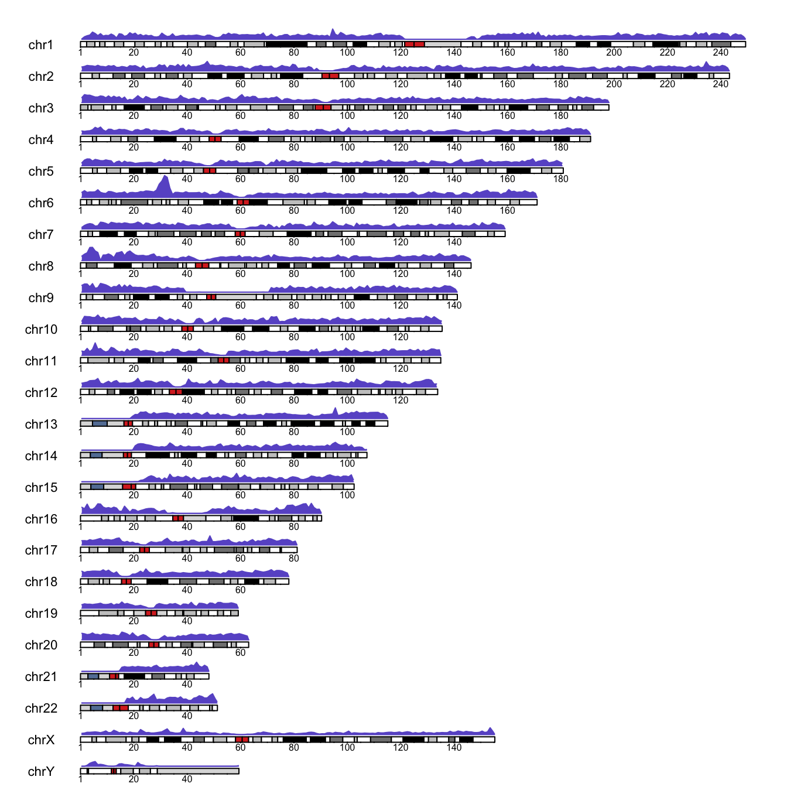
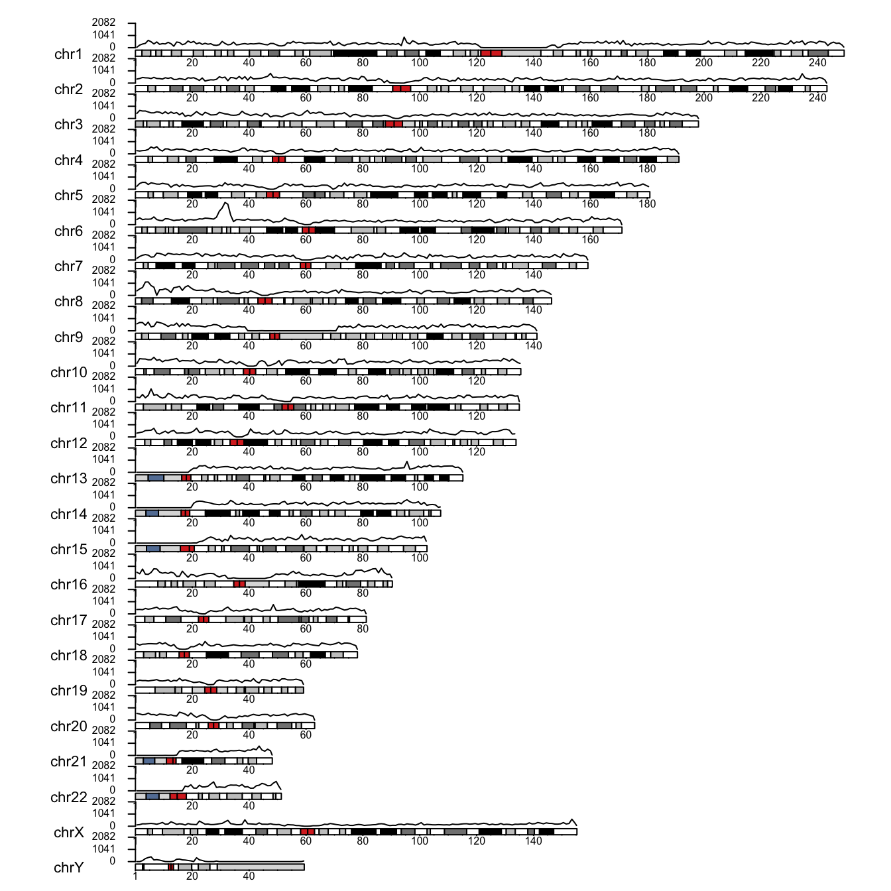
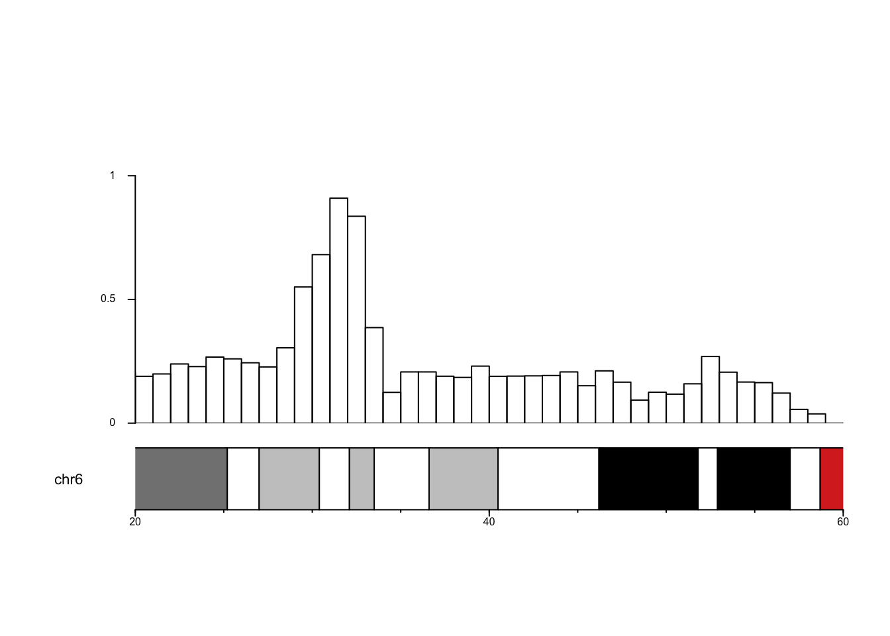

::: {.callout-note}
## Updated in 2026
This is a lightly edited version of a 2018 post. The prose and figures are the originals. The code is updated for current Bioconductor, but it is **shown, not re-run**: the SNPedia files the post relied on are no longer downloadable, so the figures below are the ones produced in 2018.
:::

## Background

[23andMe](https://www.23andme.com) is a personal genomics company that offers saliva-based, direct-to-consumer genetic testing. It is probably one of the most popular ways for people to learn more about their own genetic makeup, including ancestry.

For genotyping, the company uses a [SNP array](https://en.wikipedia.org/wiki/SNP_array) (SNP-chip). In short, such a chip lets us "read" polymorphic sites in human DNA: sites known to vary between individuals. Different versions of these sites are associated with traits such as eye colour, blood group or the risk of developing a disease. A given version does not always *cause* the phenotype. Often a SNP is a good proxy: it *tags* the phenotype. This works because DNA is inherited in rather long chunks (haplotypes), so a variant tends to travel together with its neighbours, including the actual *causative* variant. Thanks to this, genotyping a limited number of SNPs can tell you a lot about many traits.

23andMe has used three versions of its chip, introduced in 2008, 2012 and 2014. I was curious how they differ, so I wanted to visualise the density of genotyped SNPs per fixed-length window along the genome.

## The data

23andMe uses the Mendel family as its showcase. We look at the data for one family member, Lily Mendel (a real person: Linda Avey, a co-founder of the company). Data from all three chips were available at [SNPedia](https://www.snpedia.com/index.php/User:Lilly_Mendel) (2008 v1, 2012 v3 and 2014 v4). The format is simple: one row per marker, with four columns:

* `rsid` -- unique rs identifier of the marker,
* `chr` -- chromosome,
* `pos` -- coordinate of the marker,
* `gtype` -- the genotype, e.g. GG.

## Analysis

### Preparations

```{r}
# install once:
# if (!requireNamespace("BiocManager")) install.packages("BiocManager")
# BiocManager::install(c("karyoploteR", "biomaRt"))

library(karyoploteR)
```

### Loading the data

We load the data, fix the column names and convert it into a `GRanges` object, which is what the density plot needs.

```{r}
gdata <- read.table(file = "genome_Lilly_Mendel_v4.txt", comment.char = "#")
names(gdata) <- c("rsid", "chr", "pos", "gtype")

regions <- GRanges(seqnames = paste0("chr", gdata$chr),
                   ranges = IRanges(start = gdata$pos, width = 2))
```

### Plotting marker density

A karyogram is an ideogram of ordered chromosomes: a map of the genome. We plot marker density over each chromosome with `kpPlotDensity()`. A nice feature of **karyoploteR** is that it also draws the G-bands, the pattern produced by [Giemsa staining](https://en.wikipedia.org/wiki/G_banding), which cytogeneticists use to visualise chromosome structure. The one important parameter here is the window size, which I set empirically to 1 Mbp.

```{r}
kp <- plotKaryotype(cex = .7) |>
  kpAddBaseNumbers(cex = .5) |>
  kpPlotDensity(data = regions,
                window.size = 1e6,
                col = "slateblue",
                border = "slateblue")
```

{fig-alt="Karyogram of the human chromosomes with marker density drawn above each one."}

### So what?

I think the visualisation is neat, although the y-axis is missing (we fix that next). We can see low marker density around centromeres (the central, red-stained parts of the chromosomes) and a long stretch with no markers on the Y chromosome, probably its non-pseudoautosomal region. The density is also very low at the start of chromosomes 13, 14, 15, 21 and 22, and exceptionally high on the short arm of chromosome 6. I had no idea why, and not much time to research it...

### Plotting the actual counts

What if we want the counts per window rather than the density? Easy enough:

```{r}
counts <- kp$latest.plot$computed.values$density
data_counts <- GRanges(kp$latest.plot$computed.values$windows, y = counts)
max_count <- floor(max(counts) + .1 * max(counts))

# Plotting parameters established by trial and error
pp <- getDefaultPlotParams(plot.type = 1)
pp$leftmargin <- 0.15  # keep chromosome names clear of the plot
pp$topmargin <- 150    # avoid overlap between chromosomes
pp$bottommargin <- 150

kp <- plotKaryotype(cex = .7, plot.params = pp) |>
  kpAddBaseNumbers(cex = .5) |>
  kpLines(data = data_counts, ymin = 0, ymax = max_count) |>
  kpAxis(cex = .5, ymin = 0, ymax = max_count)
```

{fig-alt="Karyogram with marker counts per window drawn as a line above each chromosome."}

I did not manage to avoid all overlap between chromosomes and their data panels. It can probably be refined by playing with the graphical parameters, but you get the idea.

### Zooming in

We spotted a region of high marker density on the short arm of chromosome 6. Let's take a closer look.

```{r}
pp <- getDefaultPlotParams(plot.type = 1)
pp$leftmargin <- 0.15
pp$topmargin <- 120
to_zoom <- GRanges("chr6", IRanges(start = 20e6, end = 60e6))

kp <- plotKaryotype(cex = .7, plot.params = pp, zoom = to_zoom) |>
  kpAddBaseNumbers(cex = .5) |>
  kpAxis(cex = .5, ymin = 0) |>
  kpBars(data = data_counts, y1 = data_counts$y, ymax = max_count)
```

{fig-alt="Zoomed view of chromosome 6 between 20 and 60 megabases, with the highest marker counts around 30 to 35 megabases."}

Almost perfect; only the y-axis has vanished in a mysterious way (my fault or a feature of the package, I never found out). The highest counts occur roughly between 30 and 35 Mbp. It would be interesting to see which genes sit there.

::: {.callout-warning}
## What a real study would need
* Check the exact coordinates of the dense region rather than eyeballing 30-35 Mbp.
* 23andMe uses *hg19* coordinates, while current Ensembl uses *hg38*. The code below asks Ensembl for GRCh37 (= hg19) so the two agree. Otherwise you would lift the coordinates over, for instance with `liftOver`. I did that back then, and the regions were close enough not to matter for this post.
:::

To find the attributes and filters available in BioMart, see the [BioMart web interface](https://www.ensembl.org/biomart/martview); once you have set them, click *XML*.

```{r}
library(biomaRt)

ensembl <- useEnsembl(biomart = "genes",
                      dataset = "hsapiens_gene_ensembl",
                      GRCh = 37)

genes <- getBM(attributes = c("ensembl_gene_id", "external_gene_name", "description"),
               filters = c("chromosome_name", "start", "end"),
               values = list("6", 30000000, 35000000),
               mart = ensembl)

knitr::kable(genes)
```

## Conclusion

Now we know what sits in the region. Any guesses why 23andMe put so many markers there?
